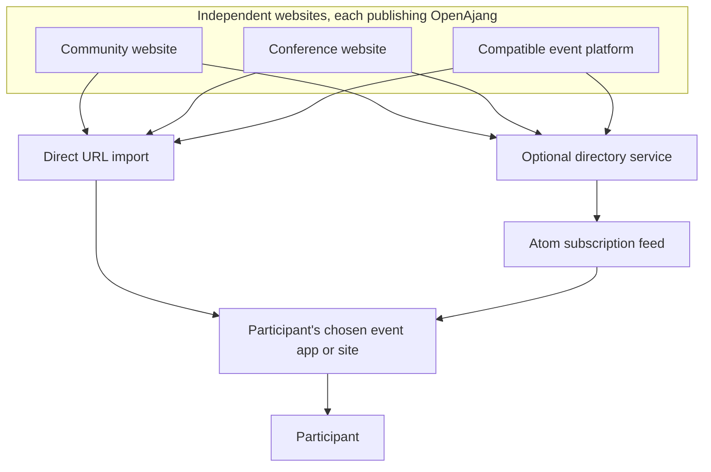

# OpenAjang

**A small JSON format for publishing public events at a URL.**

Write an event file, link to your registration form, and host it on your own website
or a static host such as GitHub Pages. Compatible apps and directories can read it,
display it, and check for changes.

The name comes from the Indonesian word _ajang_, meaning an event, occasion, or gathering place.

**Status:** Working draft. [Read the specification](SPEC.md). The format, examples, and local
tools are available for experimentation. There is no requirement to join a central
OpenAjang service.

## Why this exists

In my local tech community in Davao, I've seen organizations build their own event
platforms while events continue to be announced across Facebook, community
websites, and other event services. Each organizer has reasons for choosing where
to publish: audience reach, control, cost, or simply what their volunteers can
maintain. Participants have to piece the information together across those places.

I ran into this while building **[Naonao.ph](https://naonao.ph)**, an event platform for our small startup.
We built useful features, but convincing organizers to maintain another event
listing was still difficult. For participants, another account, another onboarding
flow, and another place to remember created friction too.

That shifted the question: **could an event be published where its organizer
already works, while people follow it through the tools they choose?**

OpenAjang explores that approach using ordinary web publishing: structured
information at stable URLs, links between representations, and feeds for discovery.
An organizer can keep registration on Google Forms or another service. A directory
can collect event links. A participant can use a compatible consumer without the
organizer having to recreate the event inside that consumer's platform.

This depends on publishers exposing compatible data. It does not automatically
extract events from Facebook or make an existing platform compatible.

## How it works



Each website publishes its own event documents. A participant can discover them
through either route in the same compatible consumer:

- **Direct import:** paste an event page or JSON URL into the app. The app retrieves
  the event from its publisher.
- **Feed discovery:** subscribe to a directory's feed. The directory collects and
  refreshes events from multiple publishers; the app follows the feed's document
  links to retrieve structured event information.

The arrows show how event information reaches the participant. In the direct route,
the participant initiates the import by supplying a URL. Directories are optional,
and different directories can index the same publishers. The consumer can keep
following saved events at their source after they leave a feed. Registration takes
participants to the organizer's chosen provider.

## Publish your first event

### 1. Write an event file

Save this as `event.openajang.json`:

```json
{
  "$schema": "https://openajang.nedpals.xyz/schema/0.1/event.json",
  "type": "event",
  "url": "https://example.org/events/build-night-2026",
  "title": "Community Build Night",
  "summary": "An evening of building and sharing projects in Davao.",
  "status": "scheduled",
  "starts_at": "2026-11-14T18:00:00+08:00",
  "ends_at": "2026-11-14T20:00:00+08:00",
  "organizer": {
    "name": "Example Community"
  },
  "location": {
    "type": "physical",
    "physical": {
      "name": "Community Hall, Davao City"
    }
  },
  "registration": {
    "required": true,
    "status": "open",
    "url": "https://docs.google.com/forms/d/e/EXAMPLE/viewform"
  },
  "updated_at": "2026-10-29T08:00:00Z"
}
```

This is an illustrative event. Replace the event details, page URL, and placeholder
Google Forms URL with your own. `url` identifies the human-readable event page; it
can be an existing website or a repository README describing that event. The JSON
file can live at a different URL.

`+08:00` records the UTC offset for the example's Philippine time. Update
`updated_at` when the published event information materially changes.

### 2. Host the file

Publish it through your website or [GitHub Pages](https://docs.github.com/en/pages/getting-started-with-github-pages/what-is-github-pages).
For example, a file committed as `build-night/event.openajang.json` in a repository
published at its root might be available at:

```text
https://your-community.github.io/events/build-night/event.openajang.json
```

Replace the owner, repository, and path with your own. The endpoint must publicly
return the JSON with `Content-Type: application/json` or
`application/vnd.openajang+json`. A normal GitHub file-view URL is an HTML page;
committing JSON to a repository alone does not provide the required JSON endpoint.
Check the hosted response rather than assuming every raw-file host serves the
accepted media type.

At this point, you have published a machine-readable event document. It does not
automatically become a rendered event page or appear in a directory. A compatible
consumer can import the JSON URL directly and provide that presentation.

### 3. Optionally link it from your event page

If you control the event page's HTML, add this inside its `<head>`:

```html
<link
  rel="alternate"
  type="application/vnd.openajang+json"
  href="./event.openajang.json"
/>
```

Here the JSON file is beside the event page. Adjust the path if it lives elsewhere.
The link must appear in the HTML response without requiring JavaScript execution.
A compatible consumer can then accept the **event page URL**, discover the linked
JSON, and import the event. Inline OpenAjang data blocks are outside this contract.

### 4. Share the URL and maintain the source

Share the direct JSON URL, or the event page URL when discovery is configured.
You can also submit it to a directory that supports OpenAjang.

Keep the event identity stable when changing its venue or time. For a cancellation,
keep the document available and set `status` to `cancelled`. Advance `updated_at`
after material changes. Compatible services can refresh that source; update timing
depends on their polling and caching policies.

Use a permanent occurrence-specific URL, or generate an explicit stable `id` once
if the page may move or be reused for next year's event. A new edition needs a new
identity. See the [identity and lifecycle rules](SPEC.md#5-identity-and-lifecycle).

## Why another format?

The [xkcd standards problem](https://xkcd.com/927/) is a fair concern.
[Schema.org Event](https://schema.org/Event),
[iCalendar](https://www.rfc-editor.org/rfc/rfc5545), and
[JSCalendar](https://www.rfc-editor.org/rfc/rfc8984) already represent much of this
information. Their capabilities are not the missing ingredient.

The hypothesis behind OpenAjang is narrower: a volunteer organizer or developer
may find it easier to maintain one small, prescribed event document with direct
registration fields and a predictable URL-import contract. It chooses one shape
for common information and keeps specialized features outside the core.

That does not mean existing standards cannot be handwritten, or that a Schema.org
profile could never meet the same need. A simpler authoring experience is a design
goal that needs testing with organizers, not a proven adoption advantage.

OpenAjang can be the editable source for generated Schema.org markup and supported
JSCalendar outputs. Services read OpenAjang directly; they do not need to convert
it to Schema.org before importing or distributing it. Conversion limitations are
reported rather than hidden. For example, an unpublished clock time is not silently
turned into an all-day calendar event.

The project earns its place only if it reduces publishing and integration work.
If it merely adds another copy to maintain, it has missed the point. Publishing
tools should generate pages and compatibility outputs from the same event record.

## For organizers, participants, and platforms

| You are…              | OpenAjang lets you…                                                                                        |
| --------------------- | ---------------------------------------------------------------------------------------------------------- |
| An organizer          | Publish an event document on hosting you choose and link to your existing registration process.            |
| A participant         | Import an event into a compatible consumer, or discover events through a directory's feed.                 |
| A platform developer  | Export event documents and provide discovery links while continuing to offer your own management features. |
| A directory developer | Fetch and validate events, retain source provenance, refresh them, and distribute links through feeds.     |

Atom is the recommended subscription format in the optional
[feed profile](FEEDS.md). Ordinary feed readers can display event
summaries and links. OpenAjang-aware consumers can retrieve structured event data
and provide event-specific behavior, such as registration actions and cancellation
notices. Saved events should continue to refresh even after they leave a feed window.

OpenAjang itself requires no central account. Hosting, registration providers,
and consumer services may have their own accounts and policies. Valid data does
not guarantee directory inclusion or prove organizer identity.

## Try the draft

Use Python 3.11 or newer. From this repository's root:

```sh
python -m venv .venv
. .venv/bin/activate
python -m pip install -r requirements.txt
python tools/openajang.py validate examples/*.openajang.json
python tools/openajang.py generate
python -m unittest discover -s tests -v
```

The repository includes eight illustrative event documents, Atom/RSS examples,
a schema and procedural validator, conversion adapters, and regression tests.
The local discovery helper is not a production network resolver. The example
listings are snapshots, not verified current announcements or endorsements.
See [publishing and implementation notes](PUBLISHING.md) for their provenance,
setup details, and operational limits.

The optional TypeScript packages [`@openajang/core`](packages/core/README.md)
and [`@openajang/resolver`](packages/resolver/README.md) are release candidates
for testing and feedback. Validation has known limitations, and the resolver
needs additional security testing. Their APIs may change before `0.1.0`.
OpenAjang documents can be published and consumed without installing either package.

```sh
npm install @openajang/core@next @openajang/resolver@next
```

## Documentation

- [Core specification](SPEC.md)
- [JSON Schema](schema/0.1/event.json)
- [Example events](examples/)
- [Optional Atom feed profile](FEEDS.md)
- [Conversion guide](CONVERSIONS.md)
- [Test report](TEST-REPORT.md)

## Help test the idea

Try publishing an event and consuming it in an independent tool. Feedback is
particularly useful on which fields are hard to write, which descriptions lead
to wrong assumptions, and whether venue changes, postponements, and cancellations
reach people who saved the event.

This is a working draft. The proposed authoring website, hosted directory, and
participant app are possible implementations, not shipped services in this
repository. The immediate goal is a small contract that independent publishers
and consumers can implement and test.

## License

- Specification and documentation (`SPEC.md`, `README.md`, `FEEDS.md`, and other `.md` files): [CC BY 4.0](LICENSE-docs). Copyright © 2026 Ned Palacios.
- Schema, examples, tools, and tests: [Apache-2.0](LICENSE). Copyright © 2026 Ned Palacios.

Third-party content (event descriptions, images, and other material published by
organizers) keeps its own terms. Publishing an event in OpenAjang format does not
license it under either license above.

You're free to implement the format and publish compatible events without asking
permission. Saying a tool or feed is "OpenAjang-compatible" is fine as long as it
follows the spec. Please don't present a modified or incompatible format as OpenAjang.
