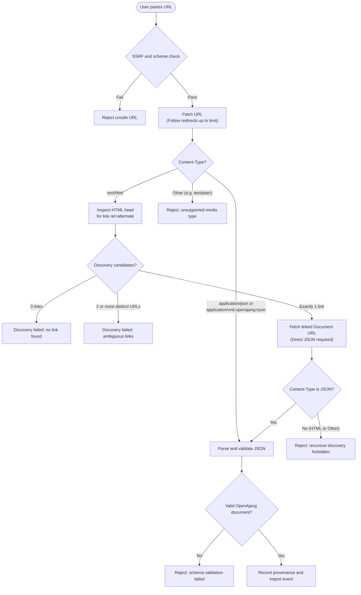

When a user pastes an event URL into an app or directory, a resolver turns that web address into a validated OpenAjang document and records where it came from. The process handles HTML discovery, network safeguards, redirect limits, and document validation ([spec §8.1](/spec/#81-inputs-and-direct-json), [§8.2](/spec/#82-html-discovery), [§8.3](/spec/#83-redirects-caching-and-refresh), [§10](/spec/#10-security-and-operational-requirements)). Terms such as Event URL and Document URL are defined in [spec §2](/spec/#2-terminology).

## What happens when someone pastes a URL

1. Accept an absolute HTTP(S) URL and check it is safe to fetch.
2. Fetch it with redirect, timeout and size limits.
3. Look at the media type of the response. An accepted JSON type means parse and validate one document. An HTML response means look for one discovery link in its head.
4. If discovery found a link, fetch that URL under the same limits. It must return JSON directly.
5. Validate the document, compare its `url` with the page you started from, and record the provenance fields.



Two URLs matter throughout. The Event URL is the public page a person visits, the value of `url` in the document. The Document URL is where the JSON was retrieved from. They can be the same address, and often are not.

## Fetch with safety limits

<aside class="doc-note" aria-label="Before fetching a URL">
<p class="doc-note-title">Before fetching a URL</p>

Resolvers accept an absolute HTTP(S) URL and fetch it subject to the security requirements below ([§8.1](/spec/#81-inputs-and-direct-json)). A URL that parses correctly is not yet safe to fetch: [§3](/spec/#3-document-and-authoring-rules) says a syntactically valid URL still needs retrieval safety checks, and [§10](/spec/#10-security-and-operational-requirements) says a syntax check alone is not SSRF protection.

</aside>

Apply the same checks to every request your resolver makes: the pasted URL, each redirect target and each discovered link.

## Branch on the media type

Compare media types case-insensitively and ignore parameters, so `application/json; charset=utf-8` matches `application/json` ([§8.1](/spec/#81-inputs-and-direct-json)).

### Accepted JSON

Documents are served as `application/vnd.openajang+json` or `application/json` ([§3](/spec/#3-document-and-authoring-rules)). For either type, parse and validate exactly one document.

If the document is invalid, report an error. The spec says an invalid JSON document is an error, not an invitation to scrape the page or fall back to another representation ([§8.1](/spec/#81-inputs-and-direct-json)).

### HTML

If the response is an HTML page, run HTML discovery. Other media types (such as the `text/plain` served by raw repository URLs) are non-conforming document endpoints ([§3](/spec/#3-document-and-authoring-rules)); report an unsupported media type error.

## Discover a document from HTML

An event page can advertise its JSON in the document head ([§8.2](/spec/#82-html-discovery)):

```html
<link rel="alternate"
      type="application/vnd.openajang+json"
      href="event.openajang.json">
```

The rules are narrow so that two resolvers reading the same page find the same document:

- Fetch the HTML without executing scripts. A link added by JavaScript does not exist.
- Only links in the `head` count. A matching link in the body is ignored.
- Match the `alternate` relation token and the vendor media type case-insensitively.
- Ignore a link without an `href`.
- Resolve `href` against the final fetched HTML URL, ignoring any HTML `<base>` element. The spec calls this deliberate, to avoid disagreement between resolvers. Absolute and relative values are both allowed.
- Deduplicate the resolved URLs after the normalization below.
- Zero candidates means not found. Two or more distinct candidates must produce an ambiguity error. Do not pick one.
- The linked endpoint must return JSON directly. Recursive HTML discovery is forbidden, so if the linked URL returns another HTML page, discovery fails and you do not look for a link on that page.
- The linked endpoint may return `application/json` even though the link advertised the vendor type.

### Compare URLs the way the spec does

When you compare discovery URLs, lowercase the scheme and host, remove default ports, resolve dot segments, treat an empty HTTP path as `/`, and remove fragments. Keep query order and path case. Do not treat HTTP and HTTPS as equal and do not strip trailing slashes. This normalization is for URL comparison only: event IDs stay opaque exact strings and must not be rewritten by it ([§8.2](/spec/#82-html-discovery)).

## Follow redirects with a limit

Consumers should follow at most five redirects and should reject an HTTPS-to-HTTP downgrade unless the app was explicitly configured to allow one. Apply retrieval safety to every redirect target, not only to the first URL ([§8.3](/spec/#83-redirects-caching-and-refresh)). Because `href` is resolved against the final fetched HTML URL, the address you end up on after redirects is the base for relative discovery links.

## Record where the event came from

Keep a source record with every imported document. [Spec §10](/spec/#10-security-and-operational-requirements) lists what directories retain. The five fields below are the core of it:

| Field | What it holds |
| --- | --- |
| Supplied URL | The URL the person pasted. |
| Final Event URL | The final fetched HTML URL after redirects, when discovery started from HTML. For direct JSON there is no fetched event page, and the page is the declared Event URL below ([§8.2](/spec/#82-html-discovery)). |
| Document URL | The URL the JSON was retrieved from, kept separate from the Final Event URL. |
| Retrieval time | When your app fetched it. This is a different clock from the document's `updated_at`. |
| Declared Event URL | The `url` value inside the document. |

For a directory, [§10](/spec/#10-security-and-operational-requirements) also names the source host and useful redirect and verification history. Retain both origins when cross-origin JSON is explicitly linked ([§8.2](/spec/#82-html-discovery)). These records feed the refresh decisions described in [Store and refresh events](/docs/store-and-refresh-events/).

Control of a host establishes where an assertion came from, not who the organizer is ([§2](/spec/#2-terminology)). A document that validates is not thereby included, endorsed, verified or live inventory ([§10](/spec/#10-security-and-operational-requirements)).

## Report relationship warnings

After you have a document, compare its declared `url` with the page you started from. What the spec asks for depends on how you got there ([§8.2](/spec/#82-html-discovery)).

- Discovery started from HTML. The document's `url` should equal the final HTML URL under the comparison rules above, or an unambiguous head canonical link resolved by the same rules. If it does not, report a relationship warning. Do not silently present the result as officially endorsed by that page.
- The URL was direct JSON. `url` is the human page the document declares and need not equal the Document URL. Cross-origin JSON is allowed when it is explicitly linked. A direct document's claim to another site does not establish authority over that site.

A warning is a result your app shows or records. The spec does not say the import must fail on one.

## Security requirements for a network-facing resolver

All fetched data is untrusted: render text without executing markup or extension values ([§10](/spec/#10-security-and-operational-requirements)). A resolver that fetches URLs people give it on a server must do all of the following:

- Block loopback, private, link-local, multicast and other non-public addresses.
- Reject URL credentials.
- Defend against DNS rebinding.
- Recheck the actual connection destination on redirects and on discovered links.
- Omit ambient cookies and credentials.
- Isolate retrieval from internal networks.

Configure redirect, timeout, compressed byte and decompressed byte limits. A 1 MiB limit for JSON is recommended. HTML scanning also needs a bounded limit, and the spec does not give a number. Directories also apply moderation and rate limits ([§10](/spec/#10-security-and-operational-requirements)).

In browser environments, [Cross-Origin Resource Sharing (CORS)](https://developer.mozilla.org/en-US/docs/Web/HTTP/CORS) restricts client scripts from reading third-party endpoints unless the remote host returns appropriate `Access-Control-Allow-Origin` headers. Applications accepting arbitrary event URLs typically perform resolution on a backend server, which also isolates network retrieval from user devices.

## What the reference tools cover

The repository's Python helper for HTML discovery is bounded and reads explicit `<head>` links, but it is not a complete HTML5 parser. [`PUBLISHING.md`](https://github.com/nedpals/openajang/blob/master/PUBLISHING.md) says a production service still needs integration-tested fetching, conditional requests, redirects, caching, SSRF and DNS rebinding protection, isolation, moderation and notification behavior. For the TypeScript resolver and its known limits, see [SDKs and tools](/docs/sdks-and-tools/).

## URL resolver checklist

[Spec §9](/spec/#9-extensions-versions-and-conformance) defines a URL Resolver as covering discovery, relationship checks, limits and retrieval security. Each row names the section the rule comes from.

| Check | Source |
| --- | --- |
| Accept an absolute HTTP(S) URL and fetch it subject to the security requirements. | [§8.1](/spec/#81-inputs-and-direct-json) |
| Treat a URL that only passes a syntax check as unchecked, not as safe. | [§3](/spec/#3-document-and-authoring-rules), [§10](/spec/#10-security-and-operational-requirements) |
| Compare media types case-insensitively and ignore parameters. | [§8.1](/spec/#81-inputs-and-direct-json) |
| For an accepted JSON type, parse and validate exactly one document. | [§8.1](/spec/#81-inputs-and-direct-json) |
| Report invalid JSON as an error without scraping or falling back. | [§8.1](/spec/#81-inputs-and-direct-json) |
| Fetch HTML without executing scripts. | [§8.2](/spec/#82-html-discovery) |
| Count only head links with the `alternate` relation token and the vendor media type. | [§8.2](/spec/#82-html-discovery) |
| Resolve `href` against the final fetched HTML URL and ignore `<base>`. | [§8.2](/spec/#82-html-discovery) |
| Ignore links without `href` and deduplicate by the normalized URL. | [§8.2](/spec/#82-html-discovery) |
| Report zero candidates as not found. Produce an ambiguity error for multiple distinct candidates (must). | [§8.2](/spec/#82-html-discovery) |
| Require the linked endpoint to return JSON directly (must). Do no recursive HTML discovery. | [§8.2](/spec/#82-html-discovery) |
| Report a relationship warning when `url` does not match the final HTML URL or an unambiguous head canonical link (the spec says `url` should match). Do not claim endorsement. | [§8.2](/spec/#82-html-discovery) |
| Retain both origins for cross-origin JSON. | [§8.2](/spec/#82-html-discovery) |
| Follow at most five redirects (should). | [§8.3](/spec/#83-redirects-caching-and-refresh) |
| Reject HTTPS-to-HTTP downgrades unless configured otherwise (should). | [§8.3](/spec/#83-redirects-caching-and-refresh) |
| Apply retrieval safety to every redirect target. | [§8.3](/spec/#83-redirects-caching-and-refresh) |
| Block loopback, private, link-local, multicast and other non-public addresses (must). | [§10](/spec/#10-security-and-operational-requirements) |
| Reject URL credentials (must). | [§10](/spec/#10-security-and-operational-requirements) |
| Defend against DNS rebinding (must). | [§10](/spec/#10-security-and-operational-requirements) |
| Recheck actual connection destinations on redirects and discovered links (must). | [§10](/spec/#10-security-and-operational-requirements) |
| Omit ambient cookies and credentials, and isolate retrieval from internal networks (must). | [§10](/spec/#10-security-and-operational-requirements) |
| Configure redirect, timeout, compressed and decompressed byte limits. Use a bounded HTML scan limit. A 1 MiB JSON limit is recommended. | [§10](/spec/#10-security-and-operational-requirements) |
| Record supplied URL, final Event URL, Document URL, retrieval time and declared Event URL. Directories also keep source host and redirect or verification history. | [§10](/spec/#10-security-and-operational-requirements) |

## Next

- [Store and refresh events](/docs/store-and-refresh-events/): what to do once the document is saved and needs to stay current.
- [Directory feeds](/docs/directory-feeds/): when events arrive through an Atom feed instead of a pasted URL.
- [SDKs and tools](/docs/sdks-and-tools/): the TypeScript resolver and the reference CLI.
